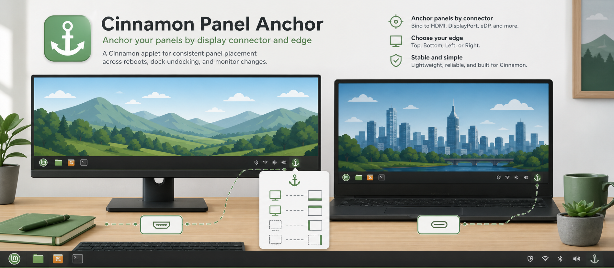
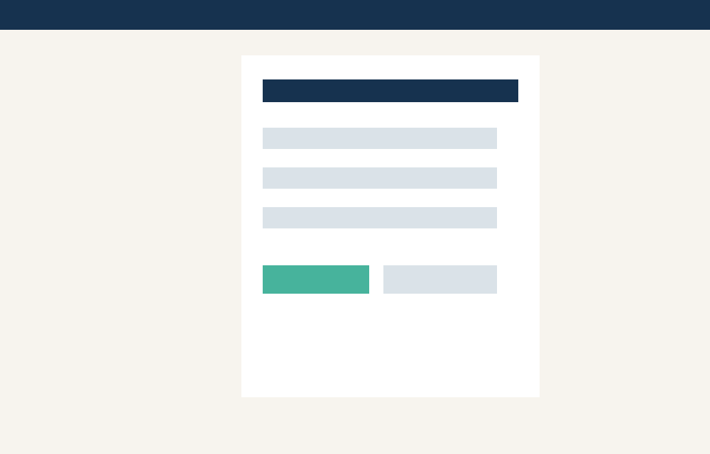
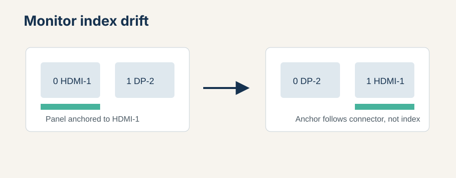

# Cinnamon Panel Anchor




[](pyproject.toml)
[](docs/install.md)
[](LICENSE)

Cinnamon Panel Anchor v0.2.1 is a native Cinnamon applet backed by a small Python utility. It keeps Cinnamon panels attached to the monitor connector and edge you chose, even when XRandR monitor indexes change after login, dock, wake, or hotplug events.

The applet is the resident UI and controller. The CLI remains backend, installer, diagnostics, and release tooling.

Public applet UUID: `cinnamon-panel-anchor@cruxexperts.com`.

## Features

- Native Cinnamon panel applet with protected, working, attention, and error states.
- Custom panel-anchor logo and state icons, so the panel icon is recognizable instead of a generic theme checkmark.
- Dashboard for health, saved anchors, current monitors, panel entries, pending decisions, and diagnostics.
- Actions for refresh, capture, restore, keep-current, display settings, diagnostics copy, and applet settings.
- Explicit lifecycle controls: **Quit for Session** hides the applet until Cinnamon reloads; **Disable Applet** removes the persistent Cinnamon enabled-applet entry.
- Optional legacy XDG autostart watcher, off by default and controlled separately from Cinnamon's normal applet startup.
- JSON backend commands for applet integration: `status`, `capture`, `restore`, `diagnose`, `autostart-status`, `install-autostart`, `uninstall-autostart`, `disable-applet`, and `log-event`.
- Local diagnostic log at `$XDG_STATE_HOME/cinnamon-panel-anchor/debug.jsonl` with the latest 1000 records retained.
- Source installer and Cinnamon Spices export tooling.
- No display-primary changes. The project never calls `xrandr --primary`.

## Dashboard Preview



Generated mockup for development documentation. Replace with a real Cinnamon screenshot before Spices submission.


## Install From Source

```bash
uv sync --python /usr/bin/python3
uv run pytest
uv run cinnamon-panel-anchor install-applet --enable
```

Use `/usr/bin/python3` on Linux Mint so the virtual environment matches the system PyGObject extension ABI. The runtime uses Cinnamon's system Gio bindings; no GTK Python wheels are vendored.

`install-applet` copies the applet and writes a small backend launcher inside the installed applet directory so Cinnamon can call the same Python environment used for installation.

## First Run

1. Arrange your Cinnamon panels where you want them.
2. Install and enable the applet:

   ```bash
   uv run cinnamon-panel-anchor install-applet --enable
   ```

3. Open the applet from the Cinnamon panel.
4. Choose **Capture Current Layout**.
5. Use **Restore Saved Anchors** after monitor index drift or let the applet surface attention states.

## Backend CLI

```bash
uv run cinnamon-panel-anchor status --json
uv run cinnamon-panel-anchor capture --json
uv run cinnamon-panel-anchor restore --json --dry-run
uv run cinnamon-panel-anchor restore --json
uv run cinnamon-panel-anchor diagnose --json
uv run cinnamon-panel-anchor export-spice dist
```

Legacy autostart watcher commands remain available for development and migration, but they are not the default release path.

```bash
uv run cinnamon-panel-anchor autostart-status --json
uv run cinnamon-panel-anchor install-autostart --json
uv run cinnamon-panel-anchor uninstall-autostart --json
```

## Documentation

- [Install guide](docs/install.md)
- [User guide](docs/user-guide.md)
- [Troubleshooting](docs/troubleshooting.md)
- [Architecture](docs/architecture.md)
- [UI design patterns](docs/ui-design-patterns.md)
- [Migration guide](docs/migration.md)
- [Spices submission notes](docs/spices-submission.md)
- [Versioning](docs/VERSIONING.md)
- [Publishing checklist](docs/PUBLISHING_CHECKLIST.md)

## How It Works



The backend reads Cinnamon's `org.cinnamon panels-enabled` entries and maps their monitor indexes through `xrandr --listmonitors`. Saved anchors store connector plus edge, not transient monitor index.

## Maintainer

Copyright 2026 Crux Experts LLC.

Maintainer: Slavic Kozyuk.

GitHub: https://github.com/CruxExperts

Company: https://www.cruxexperts.com
